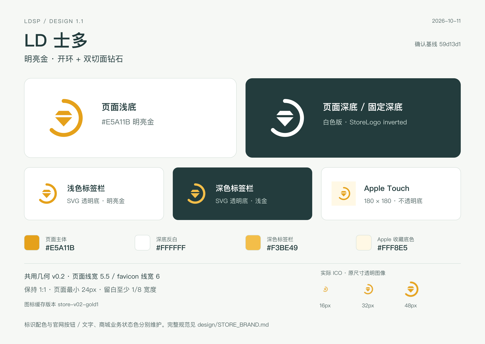
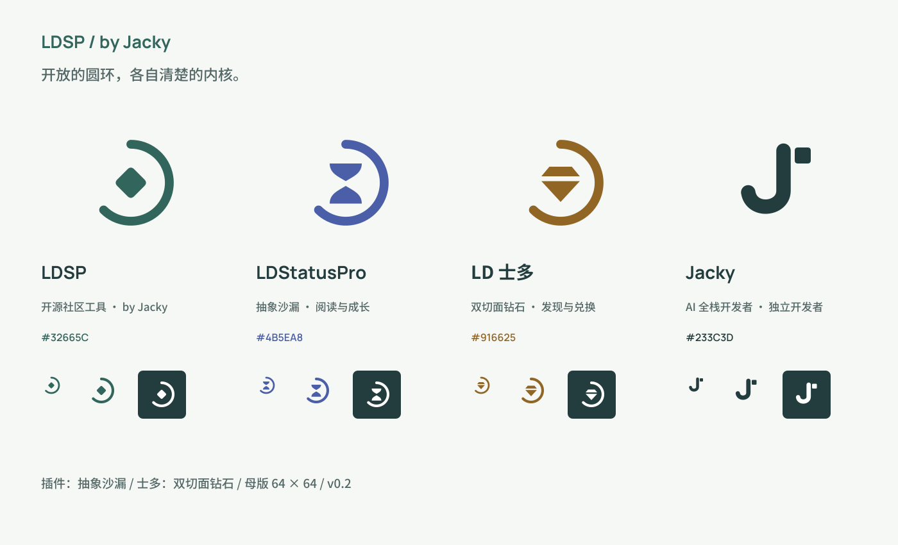
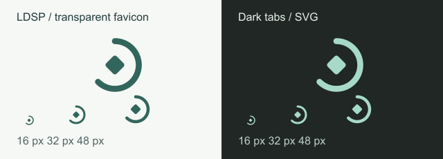
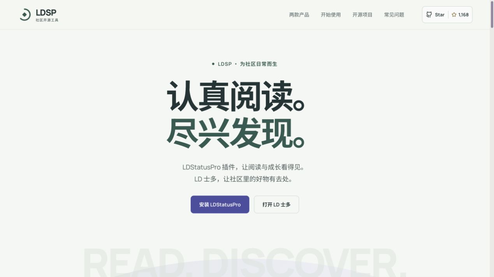

# LDSP 品牌与设计规范

**状态：现行规范 · v1.1 · 2026-10-11（Asia/Shanghai）**

本目录是 LDSP 项目的品牌、运营表达和界面设计依据。官网基线为 `9842b08`；LD 士多标识以 Jacky 在[更换网页端 LD 士多 LOGO](codex://threads/01a12b52-6a43-75d3-beb0-32ce44460590)中最终确认的明亮金钻石及商城提交 `59d13d1` 为准，共用几何仍为 v0.2。后续官网、插件、LD 士多、帮助中心、卖家端、公开文档和传播素材都以这里的现行规则为准；各产品功能和业务信息保持自己的结构。

**LD 士多当前标识：开环＋双切面钻石，主体明亮金 `#E5A11B`，深色页面反白。** 不再以官网基线里的矿金 `#916625` 作为商城 Logo 主色；官网现有按钮、文字和业务主题保持各自用途。

## 从这里开始

| 文件 | 用途 |
| --- | --- |
| [品牌与运营方案](BRAND_STRATEGY.md) | 名称、定位、双产品入口、Jacky 个人 IP、渠道、内容节奏、90 天计划与指标口径 |
| [设计语言](DESIGN_LANGUAGE.md) | 颜色、字体、布局、组件、文案、桌面／平板／手机适配 |
| [Logo 与静态资源规范](LOGO_GUIDELINES.md) | 沙漏、钻石、开放圆环、透明 favicon、分享图、字体许可与资源用法 |
| [LD 士多专属规范](STORE_BRAND.md) | 最新明亮金钻石、页面与标签栏主题、统一组件、平板侧栏及商城资源入口 |
| [动效与产品展示规范](MOTION_AND_MEDIA.md) | 组件反馈、滚动编排、减少动态效果、真实界面与高清截图 |
| [维护与验收](GOVERNANCE.md) | 规则优先级、资源同步、变更步骤和交付检查 |
| [变更记录](CHANGELOG.md) | 已确认的品牌与设计决策 |
| [现行资源清单](manifest.json) | 可检查的来源路径、SHA-256 与派生文件列表 |
| [规范版本元数据](standard.json) | 现行版本、确认会话、官网／商城基线及士多专属配色 |

## 目录与版本边界

```text
design/
  README.md                    现行规范入口
  BRAND_STRATEGY.md             品牌与运营方案
  DESIGN_LANGUAGE.md            视觉、交互与终端适配
  LOGO_GUIDELINES.md            标志与资产用法
  STORE_BRAND.md                LD 士多最新产品标识规则
  MOTION_AND_MEDIA.md           动效和真实产品展示
  GOVERNANCE.md                 更新与验收规则
  CHANGELOG.md                  决策记录
  system/                      官网身份、CSS 与商城标识生成源的镜像
  assets/brand/                官网基线标志、分享图、字体与许可
  assets/icons/                LDSP 官网透明 SVG / ICO
  assets/store/                LD 士多明亮金／反白标志、透明 favicon、收藏图标
  assets/product/              当前插件面板和士多高清截图及来源
  examples/                    最新士多规范图、官网基线与透明图标参考
  scripts/sync-assets.mjs       资源同步与一致性检查
  archive/2026-10-11-v0.1/      原始品牌运营提案及完整离线资源
```

`archive/` 仅用于追溯。其中的状态刻度／表格内核、商店内核、旧配色、旧首屏文案和较重的个人展示结构已被后续确认替代，不能作为新设计的起点。原提案里的公开计数、核验范围和实施状态只代表其采集时刻。

规范文本在 `design/` 维护。共用标志几何与官网配色源为 [website/brand/identity.json](../website/brand/identity.json)；**商城标识的配色源**为 [build-brand-assets.cjs](../ld-store/scripts/build-brand-assets.cjs) 的 `storeColors`。官网布局与动效分别在 [brand.css](../website/src/brand.css) 和 [useHomepageMotion.ts](../website/src/hooks/useHomepageMotion.ts) 实现；`system/` 与 `assets/` 是按这些来源生成的同步产物，避免在两处分别修改同一份资源。

制作新的士多标识素材时，直接使用 [明亮金 SVG](assets/store/brand/store-mark.svg) 或 [反白 SVG](assets/store/brand/store-mark-white.svg)。`assets/brand/store-*`、官网旧规范图及既有截图中的矿金图形是官网基线记录，不是最新商城 Logo 的取色依据。

在仓库根目录执行：

```bash
node design/scripts/sync-assets.mjs          # 已确认设计更新后同步归档
node design/scripts/sync-assets.mjs --check  # 检查归档与实现资源是否一致
```

同步不会发布网站、加载应用环境变量或连接生产业务服务。它也不自动把设计提案变成已确认的标准；新决策需按 [维护规则](GOVERNANCE.md) 记录。



以下图片记录官网 `9842b08` 的既有发布状态。它们保留用于核对部署和采集来源，其中的矿金士多图形不作为新的商城标识或传播素材。






